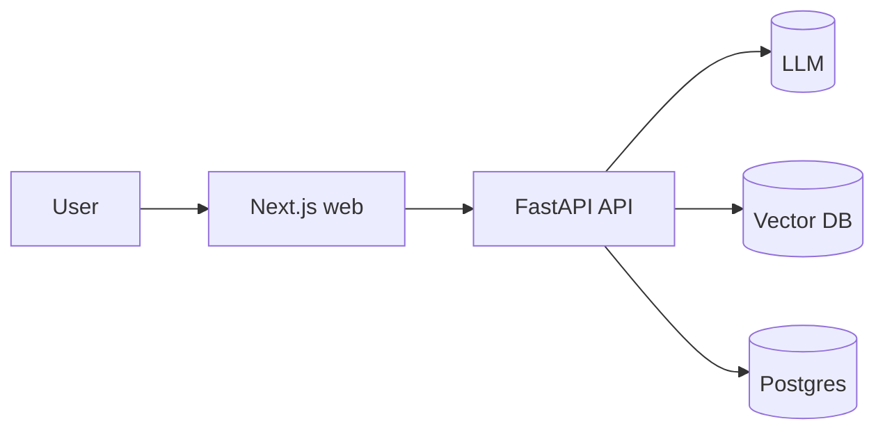

# README and demo (reference for demo-docs)

Judges score what they see in 3 minutes plus what they can verify in the repo. Make both effortless.

## 1. Timeline (relative to deadline D)
- **D − max(2 h, 15 %)**: feature freeze. Only fixes. Final review round dispatched.
- **D − 90 min**: README, diagram, demo script drafted. DEMO_REPLAY recorded on the final build.
- **D − 60 min**: clean-clone verification. Backup video recorded.
- **D − 30 min**: full rehearsal with the timer, twice. Submission materials ready → human approves.

## 2. Clean-clone verification (catches "works on my worktree")
`node .orca-team/tools/gates.mjs fresh-clone` clones into a temp folder, copies `.env`, runs
`npm run bootstrap` and `npm run ci`. Then walk the golden path once by hand on `npm run dev`. Every
deviation = README fix or bug.

## 3. README (judges read the top 30 lines)
~~~markdown
# <Project name> — <one-line value proposition>
<Problem in 2 sentences. Who it helps. Live demo URL / video link.>

## What it does
- <MUST feature 1 — user-visible outcome>
- <MUST feature 2> · <WOW feature>

## Architecture

<3 bullets: key design decisions and why (from STATUS.md "Decisions")>

## Production-grade by design (numbers from `npm run gates`)
- AI quality: <held-out pass rate> on <n> held-out cases, judged by a different model family
- Retrieval: Recall@5 <x> on <n> golden queries · Red team: <x>/<n> attacks blocked (OWASP LLM Top 10 2026)
- Tests: <n> passing, coverage <x> % · Contract tests (Schemathesis) clean · E2E incl. error states + a11y
- Reliability: timeouts, retries, fallback model, circuit breaker, health/readiness probes, streaming
- Observability: every LLM call traced (tokens, cost, latency, TTFT) → `/ops` dashboard; p95 <x> ms

## Run it
Prereqs (Node 22, uv) · `cp .env.example .env` (fill keys) · `npm run up` · open http://localhost:3001 ·
demo inputs in `docs/demo-inputs.md` · live: <web url>
## Configuration — table of env vars (name, required, purpose)
## Testing — `npm run ci` (fast) · `npm run gates` (all 16 role checks) · `npm run eval`
## Known limitations and next steps — honest, short
~~~

## 4. Three-minute demo script (`docs/demo.md`)
| Time | Beat | Content |
|---|---|---|
| 0:00–0:20 | Hook | The user, the pain, one number if you have it |
| 0:20–1:50 | Live golden path | Every PLAN.md §2 step, pre-filled inputs, narrate outcomes not clicks |
| 1:50–2:30 | Under the hood | Diagram + 3 production-grade proofs (eval score, tests/CI, security review, latency) |
| 2:30–3:00 | Impact + next | Who benefits, what's next, ask |
Prepare `docs/demo-inputs.md` with copy-paste inputs. Keep one "wow" moment in the middle, not at the end.

## 5. Judging-criteria evidence map (put in `docs/demo.md`)
| Criterion (from TASK.md) | Evidence in the product | Where we show it (demo beat / README section) |
|---|---|---|

## 6. Demo safety
- Seed data loaded; golden-path inputs tested on the final build.
- `DEMO_REPLAY=record` run of the golden path on the final build → switch to `replay` if the provider or
  network misbehaves on stage (say so honestly if asked).
- Backup screen recording of the full golden path (Windows: Win+Alt+R with Xbox Game Bar, or OBS).
- Local run ready even if the deploy exists; browser tabs pre-opened; zoom 125 %; notifications off;
  1920×1080 tested.

## 7. Submission checklist (LEAD asks the human before submitting or making anything public)
`node .orca-team/tools/gates.mjs promote` green · repo visibility per rules · README complete · live URL
working (`gates.mjs deploy`) · video uploaded · slides if required · license if required · `.env` not in the
repo (`git ls-files .env` empty) · final commit tagged.
