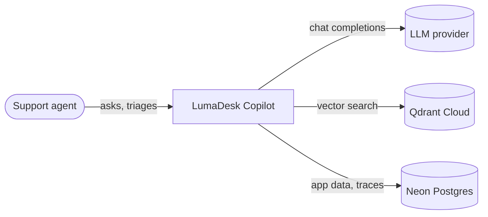
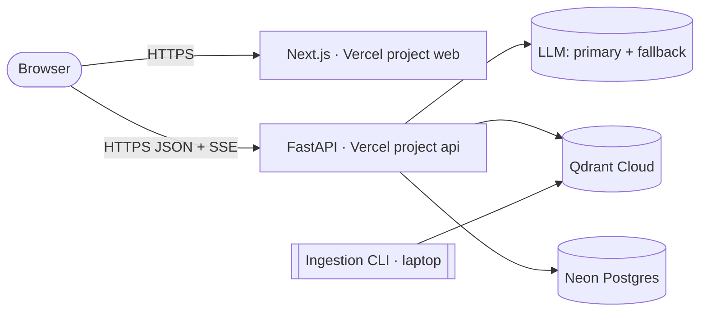

# Solution Architecture — Role 3 · Design hat

**Seat:** LEAD (models: `swarm-lead/references/model-routing.md`). **Independent check:** the DESIGN seat (another family) reviews the views
and ADRs. **Hand-off:** `docs/architecture.md`, `docs/adr/NNNN-<slug>.md`, locked contracts.
**Done when:** `node .orca-team/tools/gates.mjs adr` passes and the contracts gate (`gates.mjs hat design`)
is green before wave 1 is dispatched.

Read `references/blueprint.md` first: default stack, repo layout, ownership, ports, root scripts,
archetypes A–I. Deviate only with an ADR.

## Architecture style (decided — write it as ADR-0001)
Modular monolith + **vertical slices** (`app/features/<name>/`, `apps/web/src/features/<name>/`) +
**ports & adapters** around the LLM, embeddings, vector store and DB. Rejected: classic layered Clean
Architecture (`routes/ services/ adapters/` folders shared by everyone — every worker edits the same folders,
merge conflicts in a parallel swarm) and microservices (more deploys, network failure modes, no demo value).
Full rules and folder map: blueprint §3. One MUST capability = one slice = one CORE worker + one UI worker.

## Steps
0. **ADR-0001 architecture style** — copy the decision above; list the slices (one per MUST in the PRD).
1. **Archetype** — pick from the blueprint (RAG assistant, agentic workflow, extraction, …) or combine.
2. **C4 level 1 (context)** — users, the system, external systems (LLM provider, vector DB, Postgres, auth).
3. **C4 level 2 (containers)** — web (Next.js on Vercel), API (FastAPI on Vercel), stores, offline jobs
   (ingestion CLI run from a laptop), observability sink. Label each arrow with protocol and purpose.
4. **Deployment view** — which Vercel project hosts what, which managed service holds state, which env vars
   connect them. Serverless rule: **no state on local disk in deployed code** (only `/tmp`, ephemeral).
5. **ADRs** — one file per decision that is costly to reverse. Mandatory set: deploy target and state stores ·
   LLM provider + fallback · vector store · embedding model + dimension · streaming vs request/response ·
   auth model · ingestion (offline CLI vs request-time) · frontend data fetching (client vs server).
   Every ADR names **at least one rejected option and why** — a decision without an alternative is a guess.
6. **Lock contracts first** (before any builder starts): API = `features/<name>/schemas.py` + `ports/*.py` + stub routers →
   `npm run contracts` → `contracts/openapi.json` committed · DB = first migration drafted by DATA ·
   Eval = dataset skeleton (≥ 30 cases, split field) started by QA. Changes after lock go through LEAD only.

## `docs/architecture.md` skeleton
~~~markdown
# Architecture — <product>
## Context (C4 L1)

## Containers (C4 L2)

## Deployment
| Container | Platform | Config | State |
|---|---|---|---|
## Key flows → see docs/system-design.md
## Decisions → docs/adr/
~~~
(Mermaid also has `C4Context`/`C4Container` diagrams; flowcharts render more reliably — use them.)

## ADR template — `docs/adr/0001-<slug>.md` (gate checks these headings)
~~~markdown
# ADR-0001: <decision in one line>
## Status
Accepted · <date>
## Context
<forces: requirements, constraints, rubric lines, time>
## Decision
<what we do>
## Rejected options
- **<option>** — rejected because <reason>.
## Consequences
<what gets easier, what gets harder, revisit trigger>
~~~
Also add the one-liner to STATUS.md "Decisions".

## Review by the DESIGN seat
Read-only task: "Review docs/architecture.md and docs/adr against docs/PRD.md: missing NFR coverage,
single points of failure, serverless pitfalls (state on disk, long jobs, cold starts), slice boundaries
(two slices sharing logic that belongs in shared/), cheaper/simpler alternatives. Write `.orca-team/reviews/arch-critique.md`, max 15 bullets."

## Anti-patterns
Microservices or queues the demo doesn't need · Docker/Kubernetes work (out of scope: we ship on Vercel) ·
SQLite or local Qdrant files in deployed paths · ADRs written after the code · contracts changed by builders ·
horizontal `routes/ services/` folders that every worker edits · a feature importing another feature.
