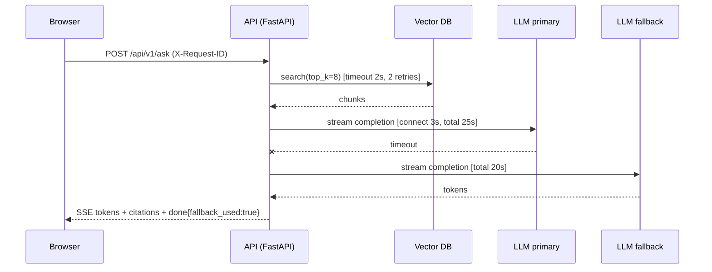

# System Design — Role 4 · Design hat

**Seat:** DESIGN (models: `swarm-lead/references/model-routing.md`), dispatched by LEAD once the architecture views exist; CORE
fills the register rows for adapters it writes. **Independent check:** LEAD (another family) reviews it,
plus the gate's code scan. **Hand-off:** `docs/system-design.md` and
fault-injection tests (`pytest -m faults`). **Done when:** `node .orca-team/tools/gates.mjs resilience` passes.

## 1. Sequence diagrams (Mermaid `sequenceDiagram`)
At least: the golden path, and the same path when the primary LLM times out (fallback or friendly error).
Show request ids, timeouts and streaming. Example:
~~~markdown

~~~

## 2. Resilience register (the gate parses this table — keep the column names)
~~~markdown
## Resilience register
| Dependency | Call site | Timeout | Retries | Fallback | Idempotent | Test |
|---|---|---|---|---|---|---|
| LLM primary | app/adapters/llm.py | connect 3s · total 25s | 2 · expo+jitter · 429/5xx/timeout only | fallback model, then problem+json 503 | yes (no side effects) | test_llm_timeout_uses_fallback |
| Vector DB | app/adapters/vectorstore.py | 2s | 2 | answer "I can't search right now" | yes | test_vector_down_degrades |
| Postgres | app/adapters/db | connect 3s · statement 5s | 0 (pool pre-ping) | 503 on /readyz, feature off | n/a | test_db_down_readyz |
~~~
Rules: no `TBD` or `-` in Timeout/Retries/Fallback · retry only transient errors (timeouts, 429, 502/503/504),
honour `Retry-After`, max 3 attempts · never retry non-idempotent writes without an idempotency key ·
every row names a test.

## 3. Latency budget
Split the NFR from the PRD across hops, e.g. TTFT 2 s = API overhead 100 ms + retrieval 400 ms + LLM first
token 1.5 s. The sum must fit the NFR; the LLM timeout must fit the Vercel function limit (300 s default).

## 4. Caching plan
| What | Key | TTL | Invalidation | Where |
|---|---|---|---|---|
| Query embeddings | sha256(model + text) | 24 h | model change | in-process LRU |
| Deterministic LLM results (temperature 0) | sha256(model + prompt version + input) | 1 h | prompt version bump | in-process / Redis |
On Vercel each instance has its own memory — caches are best-effort, never a source of truth.

## 5. Rate limits and quotas
Per client (IP or user) on LLM, search and upload routes (e.g. 20 req/min) → 429 problem+json with
`Retry-After` · request body and file size caps → 413 · `max_tokens` on every call · per-request context cap ·
daily LLM budget (`LLM_DAILY_BUDGET_USD`) → degrade to cheaper model, then 503 · provider RPM/TPM noted.

## 6. Capacity and cost estimate
Demo load (e.g. 5 concurrent users, 30 req/min), tokens per request × price per 1M tokens (look up current
prices; mark them as estimates), cost per request and per day, eval-run cost. Becomes LLMOps budget (role 15).

## 7. Failure modes (FMEA-lite)
| Failure | Detection | User sees | Mitigation | Test |
|---|---|---|---|---|
Cover: provider down / slow / 429 · malformed JSON from the model · vector DB down · DB down · empty
retrieval · oversized input · duplicate submit · cold start · deploy with missing env var (fail fast at boot).

## 8. Fault injection (proves the register)
In `APP_ENV=test` only, the adapters read `FAULT_INJECT` (comma list: `llm_timeout`, `llm_5xx`,
`llm_bad_json`, `vector_down`, `db_down`). Tests marked `@pytest.mark.faults` set it and assert the documented
behaviour (status, problem+json, fallback flag, no stack trace). The flag is ignored outside `APP_ENV=test`.

## The check
`gates.mjs resilience` verifies: `docs/system-design.md` has ≥ 1 `sequenceDiagram` and the register table
with no empty/TBD cells; and scans `apps/api/app/**/*.py` for HTTP/LLM/vector clients created without a
timeout (`httpx.Client/AsyncClient`, `OpenAI/AsyncOpenAI`, `requests.*`, `QdrantClient/AsyncQdrantClient`
with a URL). Fault tests run inside `npm run test`.

## Anti-patterns
Retrying everything · infinite or default timeouts · fallback that silently returns fake data · caches that
change answers · designing for 1M users when the demo has 5 · background work after the response on Vercel.
